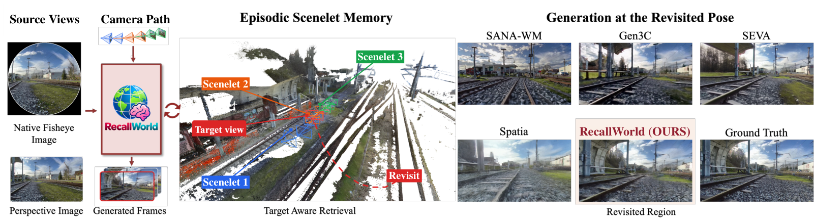

  

<h1 align="center">RecallWorld: Episodic Memory for Persistent Embodied Video World Models</h1>

  <a href="https://sarosijbose.github.io/">Sarosij Bose</a>1,2, <a href="https://scholar.google.com/citations?user=R14csHAAAAAJ">Gitika Karumuri</a>1, <a href="https://scholar.google.com/citations?user=u_lYTIwAAAAJ&amp;hl=en">Chenqi Li</a>1,3, <a href="https://tuallen.github.io/">Allen Tu</a>1,4, <a href="https://vishu26.github.io/">Srikumar Sastry</a>1,5, <a href="https://meilongzhang.github.io/">Mellon Zhang</a>1,6, <a href="https://scholar.google.com/citations?user=28p_eLYAAAAJ">Avinash Ravichandran</a>1, <a href="https://www.alexander-schwing.de/">Alexander Schwing</a>1,7, <a href="https://scholar.google.com/citations?user=4Urexvi1sIcC">Konstantinos Karydis</a>2, <a href="https://vcg.ece.ucr.edu/amit">Amit K. Roy Chowdhury</a>2

  1 <a href="https://www.amazon.science/">Amazon</a> · 2 <a href="https://www.ucr.edu/">University of California, Riverside</a> · 3 <a href="https://www.ox.ac.uk/">University of Oxford</a> · 4 <a href="https://umd.edu/">University of Maryland, College Park</a> · 5 <a href="https://washu.edu/">Washington University in St. Louis</a> · 6 <a href="https://www.gatech.edu/">Georgia Institute of Technology</a> · 7 <a href="https://illinois.edu/">University of Illinois Urbana-Champaign</a>

  

## Abstract

Video world models generate plausible novel views but often lack persistent memory, failing to preserve a place's geometry and appearance when an agent revisits a scene. A central challenge is how previous views should be effectively used for creating memory. Reconstructing them independently underutilizes geometric constraints between nearby views, while repeatedly reconstructing a growing history can propagate later prediction errors into earlier geometry. We introduce RecallWorld, a persistent embodied video world model that jointly reconstructs short multi-view episodes into Scenelets while keeping geometry independent across episodes. Starting from a single source image, camera-aware ray lifting places perspective and native fisheye images in a common world frame, retaining wide-field content for perspective generation. Each generated segment extends the Scenelet memory and conditions subsequent generation. Coverage-based retrieval selects complementary Scenelets from the full history, while target-view visibility is resolved geometrically before appearance fusion, providing consistent memory conditioning for guiding subsequent generation. Across four datasets, RecallWorld improves revisit PSNR over the strongest evaluated baseline by 2.6 dB on partial revisits and 3.9 dB on full cycles, demonstrating substantially stronger preservation of scene identity across exploration and return.

## BibTeX

The citation will be available with the arXiv release.

## Acknowledgements

This work was completed during an internship at [Amazon](https://www.amazon.science/). We thank [Ziyang Long](https://ziyanglong.cn/), [Amin Kheradmand](https://scholar.google.com/citations?user=5DJL154AAAAJ), [David Stafford](https://www.linkedin.com/in/davidwstafford), [Yen-Liang Lin](https://sites.google.com/view/yenlianglin), [Shifan Zhu](https://shifanzhu.github.io/), [Yun He](https://yunhe20.github.io/), [Guy Satat](https://guysatat.com/), [Sravan Sripada](https://www.amazon.science/author/sravan-sripada), and [Prakriti Chintalapoodi](https://www.amazon.science/author/prakriti-chintalapoodi) for helpful discussions and feedback.
